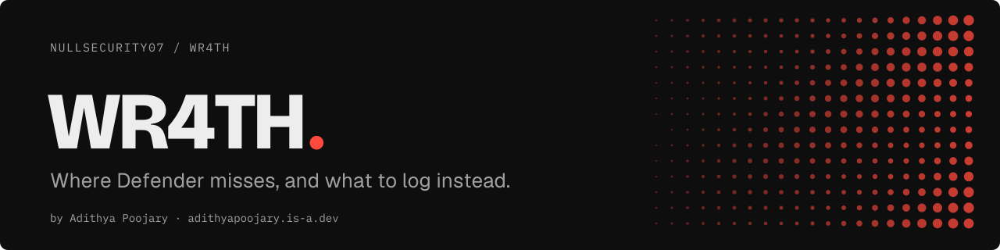

<a href="https://adithyapoojary.is-a.dev/security/"><picture><source media="(prefers-color-scheme: light)" srcset=".github/readme/banner-light.svg"></picture></a>

<picture><source media="(prefers-color-scheme: light)" srcset=".github/readme/badges-light.svg"></picture>

Research into where Windows Defender catches a multi-stage delivery chain and where it does not, written for the people who have to catch it.

## Why this exists

Antivirus is usually tested one file at a time. Real intrusions arrive in layers: a script hands off to another script, which hands off to a binary, which talks to the outside world. WR4TH looks at that chain as a whole and asks a defender's question: at which layer does detection actually fire, and what should you be logging at the layers where it does not?

## What was studied

| Layer | The question | What defenders should monitor |
|---|---|---|
| Command and control | Does traffic from a small custom controller stand out? | Unusual outbound connections from user processes, beaconing intervals, new listening ports |
| Script stage | Does in-memory script content get inspected? | AMSI events, PowerShell Script Block Logging (Event ID 4104), Module Logging |
| Dropper stage | Do chained batch and script launches look suspicious? | Process lineage (Sysmon Event ID 1), scripts spawned from Office or browsers, `cmd` to `powershell` chains |
| Exfiltration | Does mail-based data egress get flagged? | SMTP from hosts that never send mail, outbound port 25/465/587 from workstations, DLP on attachments |
| Persistence | Does a new remote-access service get noticed? | New services and scheduled tasks (Event IDs 7045, 4698), new OpenSSH server installs, changes to `authorized_keys` |

## Highlights

- **Whole-chain view.** Each layer is looked at on its own, so a gap in one layer stays visible even when another layer would have caught the attack.
- **Defender-first framing.** The table above pairs every layer with log sources a blue team can turn on today.
- **Lab only.** Meant for an isolated lab on machines you own.

## Status

Research archive. Results depend on the Defender version and configuration tested, and are not a claim about current products.

## Responsible use

This repository is for education and defensive research. Do not run any part of it against systems you do not own or have written permission to test. Unauthorized access to computer systems is illegal.

## Built by

Built by [Adithya Poojary](https://adithyapoojary.is-a.dev), founder of ThreatScope. [More projects](https://adithyapoojary.is-a.dev/work/) · [Security work](https://adithyapoojary.is-a.dev/security/) · [LinkedIn](https://www.linkedin.com/in/adithyapoojary/)
